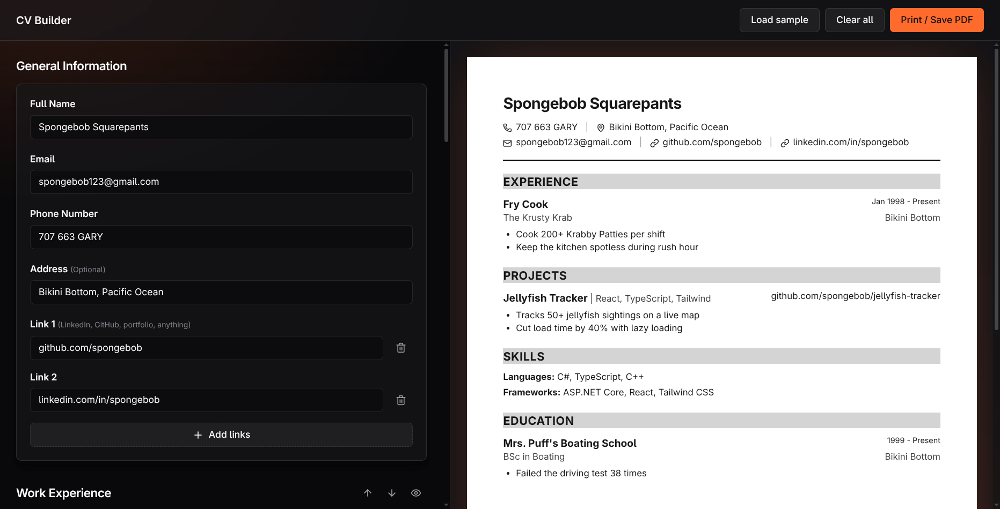

# CV Application

A dark-themed resume builder that runs entirely in your browser. Fill in the form on the left, watch an A4 page update live on the right, then print it or save it as a PDF.

**Live demo:** [eightballk.github.io/cv-application](https://eightballk.github.io/cv-application/)



## Features

- **Live A4 preview.** The page on the right is the same size as the printed one, with a marker showing where each page break will fall.
- **Flexible content.** Name and contact details, an optional address, and as many links as you want (LinkedIn, GitHub, portfolio, anything).
- **Multiple entries.** Work experience, projects, skills and education all support any number of entries, with bullet points written one per line.
- **Custom skill categories.** Name the groups yourself ("Languages", "Tools", "Certifications").
- **Full control over order.** Move entries up and down inside a section, reorder whole sections, or hide the ones you don't need. Empty sections never show up on the CV.
- **Autosave.** Everything is saved to your browser as you type. Nothing is sent to a server.
- **Print or save as PDF.** A clean print layout with proper page margins and no entries split across pages.
- **Sample data.** Load sample content to see how a finished CV looks, or clear everything to start fresh.

> [!NOTE]
> The editor is designed for desktop screens. A layout for smaller devices is planned.

## Tech stack

- React 18 and TypeScript
- Vite
- Tailwind CSS 3
- Lucide icons

## Getting started

```bash
git clone git@github.com:eightballk/CV-application.git
cd CV-application
npm install
npm run dev
```

| Command | What it does |
| --- | --- |
| `npm run dev` | Start the dev server |
| `npm run build` | Type-check and build to `dist/` |
| `npm run preview` | Serve the production build locally |
| `npm run lint` | Run ESLint |
| `npm run deploy` | Build and publish to GitHub Pages |

## Planned

- Languages and hobbies sections
- Responsive layout for phones and tablets
